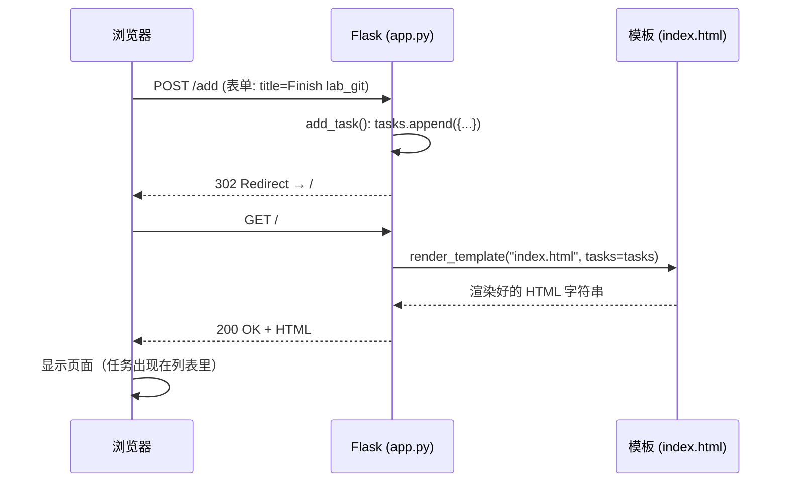

# Sprint 1 代码教学：Task Tracker（Flask + HTML + CSS）

> 配套代码：本目录（`springs/01/`）。
> 对应任务：Sprint 1 §3.A「在 feature 分支上实现 add task 与 delete task；能显示任务列表 + 能添加 + 能删除即可」。
> 目标读者：组内**没有前后端经验**的同学也能看懂、能改、能在 demo 时解释每一行代码。

---

## 目录

1. [Sprint 1 到底要做多少](#1-sprint-1-到底要做多少)
2. [5 分钟跑起来](#2-5-分钟跑起来)
3. [项目结构一眼看懂](#3-项目结构一眼看懂)
4. [一次请求的完整旅程](#4-一次请求的完整旅程)
5. [后端 app.py 逐段讲解](#5-后端-apppy-逐段讲解)
6. [前端 index.html 逐段讲解](#6-前端-indexhtml-逐段讲解)
7. [样式 style.css 讲什么](#7-样式-stylecss-讲什么)
8. [三个功能是怎么分成两个 feature 分支的](#8-三个功能是怎么分成两个-feature-分支的)
9. [Demo 脚本（Week 4 lab，15–20 分钟）](#9-demo-脚本week-4-lab1520-分钟)
10. [Tutor 可能让你现场改的地方（练习题）](#10-tutor-可能让你现场改的地方练习题)
11. [常见坑与排错](#11-常见坑与排错)
12. [为 Sprint 2/3 埋下的伏笔](#12-为-sprint-23-埋下的伏笔)

---

## 1. Sprint 1 到底要做多少

课程原话和讲师解释可以归纳成一张表：

| 要 | 不要 |
|---|---|
| 显示任务列表 | 漂亮 UI |
| 添加任务（`Add Task` 按钮） | 邮件确认 |
| 删除任务（每条一个 `Delete`） | 数据库 / 刷新后数据还在 |
| Python (Flask) + HTML/CSS | 任何 JavaScript 或其他语言 |
| 每个功能一个 feature 分支 + MR | 直接在 `main` 上改 |

讲师的最小示例是：**`My Tasks` 标题 + 输入框 + `Add Task` 按钮 + 每条任务带 `Delete`**，"这已经绰绰有余"。本目录的实现就是这个最小示例，加上少量注释和一份 CSS 让 demo 更清楚。

Features Demo 只占组分 30 分中的 5 分，**真正拿分的是过程**（MR、issue board、契约、用户故事、retro）。所以代码要小而干净、人人能解释，把时间省下来练 Git 和协作。

---

## 2. 5 分钟跑起来

```bash
cd springs/01
python3 -m venv .venv
source .venv/bin/activate
pip install -r requirements.txt
python app.py
```

浏览器打开 <http://127.0.0.1:5000>，你应该看到 "My Tasks" 和一个输入框。

可选自检（Sprint 1 不要求测试，但 demo 前跑一下心里有底）：

```bash
pytest -q
# 期望输出：6 passed
```

---

## 3. 项目结构一眼看懂

```
01/
├── app.py                 # 后端：Flask 应用 + 3 个路由
├── templates/index.html   # 前端：唯一的页面（Jinja2 模板）
├── static/style.css       # 样式
├── requirements.txt       # 依赖清单：Flask、pytest
├── tests/test_app.py      # 可选：6 个 pytest 测试
├── README.md              # How to Run / Making Your First Changes / Common Questions
└── 教学文档_Sprint1_TaskTracker.md   # 本文
```

Flask 对目录名有约定：

- `templates/` 里的文件可以用 `render_template("index.html")` 找到；
- `static/` 里的文件可以通过 `/static/xxx` 访问，模板里用 `url_for('static', filename='style.css')` 生成路径。

这两个名字是 Flask 默认的，**不要改**。

---

## 4. 一次请求的完整旅程

理解 Flask 只需要记住一句话：**一个路由 = 一个 URL + 一个 Python 函数；浏览器发请求，函数返回响应。**

以「用户输入 `Finish lab_git` 并点 Add Task」为例：



三个关键点：

1. **表单 → `request.form`**：`<input name="title">` 里用户输入的内容，后端用 `request.form.get("title")` 拿到。`name` 属性就是两边的"接头暗号"。
2. **改数据用 POST，读数据用 GET**：添加、删除都会改服务器上的数据，所以用 POST；首页只是看，用 GET。
3. **PRG 模式（Post → Redirect → Get）**：处理完 POST 后不直接返回页面，而是让浏览器重新 GET 首页。好处是用户按 F5 刷新时不会重复添加同一个任务。

删除的流程完全一样，只是 URL 换成 `POST /delete/<id>`。

---

## 5. 后端 app.py 逐段讲解

### 5.1 导入与创建应用

```python
from flask import Flask, redirect, render_template, request, url_for

app = Flask(__name__)
```

| 名字 | 作用 |
|---|---|
| `Flask(__name__)` | 创建应用对象；`__name__` 让 Flask 知道去哪找 `templates/` 和 `static/` |
| `render_template` | 读取模板文件，把 Python 变量填进去，返回 HTML |
| `request` | 当前这次请求的所有信息（表单、URL 参数、方法…） |
| `redirect` + `url_for` | 让浏览器跳到另一个 URL；`url_for("index")` 会根据函数名反推出 `/`，比硬编码 `"/"` 更安全 |

### 5.2 数据放哪里

```python
tasks: list[dict] = []
_next_id = 1
```

Sprint 1 允许数据只放内存，所以就是一个全局列表。每个任务是一个字典 `{"id": 1, "title": "..."}`。

**为什么要有 id，直接用列表下标不行吗？** 可以但有坑：如果两个人同时打开页面，A 删了第 0 条，B 页面上的"第 1 条"就变成了原来的第 2 条，B 点删除会删错。用自增 id 就不会串。这一点 tutor 很可能会问。

`_new_id()` 和 `reset_tasks()` 是两个小工具函数：前者返回下一个 id 并自增，后者清空数据（测试用）。

### 5.3 路由 1：显示列表（starter code 自带）

```python
@app.route("/")
def index():
    return render_template("index.html", tasks=tasks)
```

- `@app.route("/")` 把 URL `/` 绑定到 `index` 函数；没写 `methods` 默认只接受 GET。
- `tasks=tasks`：左边是**模板里**的变量名，右边是 **Python 里**的变量。名字相同只是巧合，可以不同。

### 5.4 路由 2：添加任务（feature-add-task）

```python
@app.route("/add", methods=["POST"])
def add_task():
    title = request.form.get("title", "").strip()
    if title:
        tasks.append({"id": _new_id(), "title": title})
    return redirect(url_for("index"))
```

逐行：

1. `methods=["POST"]`：只接受 POST。如果用浏览器直接访问 `/add`（GET），会得到 405 Method Not Allowed——这是**正确行为**，不是 bug。
2. `request.form.get("title", "")`：取表单字段；第二个参数是取不到时的默认值，避免抛 `KeyError`。
3. `.strip()` + `if title:`：去掉首尾空格，空的就不加。课程说 Sprint 1 **不要求**空输入校验，这两行是顺手写的，删掉也完全符合要求。
4. `redirect(url_for("index"))`：跳回首页（PRG）。

### 5.5 路由 3：删除任务（feature-delete-task）

```python
@app.route("/delete/<int:task_id>", methods=["POST"])
def delete_task(task_id: int):
    tasks[:] = [t for t in tasks if t["id"] != task_id]
    return redirect(url_for("index"))
```

- `<int:task_id>` 是 **URL 变量**：访问 `/delete/3` 时，Flask 自动把 `3` 转成整数传给参数 `task_id`。如果传的不是整数（如 `/delete/abc`），Flask 直接返回 404。
- `tasks[:] = [...]`：用列表推导式**保留** id 不相等的任务，等价于"删掉 id 相等的那条"。用 `tasks[:] =` 而不是 `tasks =` 是为了原地修改同一个列表对象，这样测试文件里 `import app` 拿到的引用仍然有效。
- 删除不存在的 id 不会报错，只是什么都没发生——这是有意为之的"幂等"行为。

### 5.6 启动

```python
if __name__ == "__main__":
    app.run(debug=True)
```

`debug=True` 的两个好处：改代码自动重启；出错时浏览器显示详细堆栈。**只在开发时用**，Sprint 3 如果部署要关掉。

---

## 6. 前端 index.html 逐段讲解

### 6.1 Jinja2 三种语法

模板 = HTML + 三种特殊标记：

| 写法 | 含义 | 本项目中的例子 |
|---|---|---|
| `{{ 表达式 }}` | 输出值 | `{{ task.title }}`、`{{ tasks\|length }}` |
| `` | 控制流 | ``、`` |
| `{# 注释 #}` | 模板注释（不会输出到 HTML） | — |

`{{ }}` 会**自动做 HTML 转义**：如果有人输入 `<script>alert(1)</script>` 当任务名，页面上会原样显示这串文字而不是执行它。测试 `test_task_title_is_html_escaped` 验证了这一点。

> 一个真实踩过的坑：HTML 注释 `<!-- -->` **挡不住** Jinja。如果你在注释里写 `` 当示例，Jinja 照样会解析并报 `TemplateSyntaxError`。本项目用 ` ... ` 把那段讲解注释包了起来。

### 6.2 添加表单

```html
<form class="add-form" action="{{ url_for('add_task') }}" method="post">
  <input type="text" name="title" placeholder="What needs to be done?" required>
  <button type="submit" class="btn btn-primary">Add Task</button>
</form>
```

- `action`：提交到哪；用 `url_for('add_task')` 而不是写死 `/add`，以后改 URL 只需改后端。
- `method="post"`：与后端 `methods=["POST"]` 对应。
- `name="title"`：与后端 `request.form.get("title")` 对应。**三处必须一致**，这是新手最常出错的地方。
- `required`：浏览器层面阻止空提交，只是体验优化；真正的保护在后端。

### 6.3 任务列表与删除按钮

```html

  <ul class="task-list">
    
      <li class="task-item">
        <span class="task-title">{{ task.title }}</span>
        <form action="{{ url_for('delete_task', task_id=task.id) }}" method="post">
          <button type="submit" class="btn btn-danger">Delete</button>
        </form>
      </li>
    
  </ul>

  <p class="empty">No tasks yet. Add your first one above!</p>

```

- `url_for('delete_task', task_id=task.id)` 生成 `/delete/1`、`/delete/2`……参数名 `task_id` 必须和后端函数参数名一样。
- **每条任务一个独立的小表单**，而不是一个 `<a href="/delete/1">` 链接。原因：链接是 GET，而删除会改数据；用 GET 删除意味着浏览器预加载、爬虫、甚至书签都可能误删。
- `` 空列表为假，所以没有任务时显示提示文字。

---

## 7. 样式 style.css 讲什么

课程明确说不需要漂亮 UI，这份 CSS 只做三件事，demo 时一句话带过即可：

1. **居中卡片**：`body` 用 flex 居中，`.card` 限宽 520px。
2. **一行表单**：`.add-form` 用 `display:flex`，输入框 `flex:1` 撑满，按钮靠右。
3. **列表行**：`.task-item` 用 flex 把标题和 Delete 按钮分到两端。

顶部 `:root` 里的 CSS 变量（`--primary`、`--danger`…）是为了改颜色只改一处。如果 tutor 让你"把 Delete 按钮改成灰色"，只改 `--danger` 这一行。

---

## 8. 三个功能是怎么分成两个 feature 分支的

课程要求 add 和 delete **分开做，是两件事**，并且每人 ≥1 个 MR。推荐拆法：

```
main  ──●────────────────●──────────────●──►
         \              /  \           /
          feature-add-task  feature-delete-task
          (MR !1, Closes #2) (MR !2, Closes #3)
```

| 分支 | 改动的文件 | 对应 issue |
|---|---|---|
| `feature-add-task` | `app.py` 加 `add_task()`；`index.html` 加 `<form class="add-form">` | #2 Add task (backend + frontend) |
| `feature-delete-task` | `app.py` 加 `delete_task()`；`index.html` 每条任务加 Delete 表单 | #3 Delete task |
| `docs-add-teamwork-contract` | `teamwork.md` | #1 Team contract |
| `docs-add-user-stories` | `stories.md` | #4 User stories |
| `docs-add-sprint1-retro` | `retro.md` | #5 Retro |

4–5 个人、5 个分支，刚好人人一个 MR。两个功能分支可以两人一组（一人后端、一人前端，共用分支但各自 commit）。

每个分支的标准流程：

```bash
git checkout main && git pull
git checkout -b feature-add-task
# ... 改代码 ...
git add app.py templates/index.html
git commit -m "Add task creation form and POST /add route

Closes #2"
git push --set-upstream origin feature-add-task
# GitLab 上建 MR，标题 "Add task feature"，指定组员 reviewer
# reviewer approve 后，由作者自己点 Merge
```

Commit message 要"描述性但简洁、单一目的"：✅ `Add POST /delete/<id> route to remove a task`，❌ `update`、`fix stuff`。

---

## 9. Demo 脚本（Week 4 lab，15–20 分钟）

Demo 是非正式的 Q&A，重点是**说清楚给客户带来了什么价值、怎么做到、为什么**。建议顺序：

**(1) 一句话价值（30 秒）**
"Procrastination Warriors 用便利贴记任务会忘。我们的 Task Tracker 让他们在一个页面上添加和删除待办事项，随时知道还剩什么没做。"

**(2) 现场操作（2 分钟）**
1. 打开 <http://127.0.0.1:5000>，指出空状态提示。
2. 添加 `Write teamwork.md`、`Open MR for add-task`、`Sprint retro` 三条。
3. 指出底部 "3 tasks" 计数。
4. 删除中间那条，指出只有它消失、计数变成 2。
5. 按 F5 刷新，说明不会重复提交（PRG）。

**(3) 代码走读（5 分钟）**
按 §4 的顺序讲：表单 `name="title"` → `request.form.get("title")` → `tasks.append` → `redirect` → `render_template` → ``。每人负责讲自己写的那段。

**(4) 过程证据（5 分钟）**
切到 GitLab：Issue board（每个功能一个 issue，已 Closed）→ Merge Requests（每人一个，有 reviewer approve 记录）→ 分支命名 → `teamwork.md` / `stories.md` / `retro.md`。

**(5) 留 5 分钟给 tutor 提问**，包括可能的"现场改一行代码"。

---

## 10. Tutor 可能让你现场改的地方（练习题）

课程明确说：tutor 可能要求现场改一行代码或加一个小功能，以确认是你自己写的。做不到会被视为不了解自己的工作。每个组员都应该能独立完成下面任意一题（每题 1–3 行改动）：

| # | 题目 | 改哪里 | 提示 |
|---|---|---|---|
| 1 | 把标题 "My Tasks" 改成 "Team Tasks" | `templates/index.html` | 改 `<h1>` |
| 2 | 新任务放到列表**最前面**而不是最后 | `app.py` `add_task()` | `tasks.insert(0, {...})` |
| 3 | 允许添加空任务（去掉保护） | `app.py` `add_task()` | 删掉 `if title:`，缩进回退 |
| 4 | 任务名前面显示序号 `1. 2. 3.` | `templates/index.html` | 用 `{{ loop.index }}.` |
| 5 | Delete 按钮改成灰色 | `static/style.css` | 改 `--danger` 变量 |
| 6 | 加一个 "Clear all" 按钮清空全部 | `app.py` + `index.html` | 新路由 `POST /clear`，调用 `tasks.clear()` |
| 7 | 限制任务名最多 50 个字符 | `app.py` `add_task()` | `title = title[:50]` |
| 8 | 显示每条任务的 id | `templates/index.html` | `#{{ task.id }}` |

练法：每人抽两题，在本地分支上改、看效果、再 `git checkout .` 还原。

---

## 11. 常见坑与排错

| 现象 | 原因 | 解决 |
|---|---|---|
| `ModuleNotFoundError: No module named 'flask'` | 没激活 venv 或没装依赖 | `source .venv/bin/activate && pip install -r requirements.txt` |
| 访问 `/add` 显示 405 | 用 GET 访问了只接受 POST 的路由 | 正常，通过页面表单提交即可 |
| 点 Add 后任务没出现 | `name="title"` 和 `request.form.get("title")` 不一致 | 三处名字对齐（§6.2） |
| 点 Delete 删错了条 | 用了列表下标而不是 id | 见 §5.2 |
| `TemplateSyntaxError` | HTML 注释里写了 `` 或 `{{ }}` | 用 `` 包起来，或删掉 |
| `jinja2.exceptions.UndefinedError: 'task' has no attribute 'title'` | 字典 key 写错 | 检查 `tasks.append` 里的 key |
| 改了代码没生效 | 没开 debug 或没刷新 | 用 `python app.py`（内置 `debug=True`），刷新浏览器 |
| 刷新后数据没了 | 内存存储 | 正常；Sprint 1 允许 |
| 端口 5000 被占用（macOS AirPlay 常见） | 系统服务占用 | `flask --app app run --port 5001` |

---

## 12. 为 Sprint 2/3 埋下的伏笔

现在的代码故意留了几个"接口"，方便后续 Sprint 直接扩展而不用重写：

| 现在 | Sprint 2/3 可以怎么长 |
|---|---|
| 任务是 dict `{"id", "title"}` | 直接加字段：`done`、`assignee`、`due_date`，模板对应加一列 |
| 有独立 id | 编辑功能 `POST /edit/<id>`、标记完成 `POST /toggle/<id>` 都靠 id 定位 |
| `reset_tasks()` + `tests/test_app.py` | Sprint 2 要求测试 + CI，`conftest.py` 的 fixture 可以直接沿用 |
| `tasks` 是全局列表 | Sprint 3 持久化：启动时从 `tasks.json` 读、每次改动后写回，只改 3 个函数 |
| `url_for` 而非硬编码 URL | 加 blueprint / 改路径时模板不用动 |
| CSS 变量 | 主题、深色模式只改 `:root` |

但请记住课程的提醒：**Sprint 2 起功能由你们自己的用户故事决定**，先写故事和验收标准，再决定往哪个方向长。
