# 🏆 Sprint 2 Guidelines　🏆 Sprint 2 指南

COMP9820 Project
　COMP9820 项目

💰🧾 Shared Expense Splitter 🧾💰
　💰🧾 共享费用分摊器 🧾💰

Last modified: Tuesday, 27 October 2026, 1:56 PM
　最后修改：2026 年 10 月 27 日（周二）下午 1:56

（本文件为 Moodle「Assessments Hub → 🏆 Sprint 2 Guidelines」页面的中英对照整理版；页面顶部的导航栏、底部的 UNSW 页脚与 Acknowledgement of Country 不属于指南正文，已省略。）

---

## 🌈 1. Overview　🌈 1. 概览

In Sprint 1, every team built the same generic Shared Expense Splitter: groups, expenses, splits, net balances, edit and delete, and history.
　在 Sprint 1 中，每个团队做的都是同一个通用版的共享费用分摊器：群组、费用、分摊、净余额、编辑与删除，以及历史记录。

Whereas in Sprint 2, your team adapts its Sprint 1 build for one specific scenario (variation). You choose a target user, describe their problem, and write and deliver the user stories that solve it. Your Sprint 1 code is the base each variation extends; no additional code will be supplied.
　而在 Sprint 2 中，你们团队要把 Sprint 1 的成果改造成面向某一个具体场景的产品（称为"变体 / variation"）。你们要选定目标用户、描述他们的问题，然后编写并交付能解决该问题的用户故事。Sprint 1 的代码就是每个变体赖以扩展的基础；课程不会再提供任何额外代码。

Alongside the variation, your team introduces a continuous integration (CI) pipeline. Every push and merge request will be built, linted and tested automatically, so that the team can see at a glance whether main still works. As more people change more code, the pipeline becomes the shared safety net that lets the team integrate work with confidence.
　在做变体的同时，团队还要引入一条持续集成（CI）流水线。每一次 push 和每一个 merge request 都会被自动构建、自动 lint、自动测试，这样全组一眼就能看出 main 分支是否还能正常工作。改代码的人越多、改动越多，这条流水线就越成为大家放心集成工作的共同安全网。

By the end of Sprint 2, your team should have a working variation that serves a clearly defined user, a CI pipeline that runs on every merge request, and evidence that the work was planned, tracked, reviewed and integrated as a team.
　到 Sprint 2 结束时，团队应该拥有：一个服务于明确目标用户、能正常运行的变体；一条在每个 merge request 上都会运行的 CI 流水线；以及能证明这些工作是以团队方式计划、跟踪、评审和集成的证据。

---

## 🐭 2. Sprint 2: Variations & Continuous Integration　🐭 2. Sprint 2：变体与持续集成

With the Shared Expense Splitter generic functionality established, Sprint 2 focuses on improving the generic Shared Expense Splitter web application into a specific defined product following your chosen variation. The team will begin establishing more targeted user stories, use cases, and success criteria that describe what the variation must achieve.
　共享费用分摊器的通用功能已经建立，Sprint 2 的重点是按照你们选定的变体，把这个通用的 Web 应用改进成一个定义明确的具体产品。团队将开始建立更有针对性的用户故事、用例和成功标准，用来描述该变体必须达成什么。

More specifically, below are the goals for Sprint 2:
　更具体地说，Sprint 2 的目标如下：

- You will continue practising Agile software team principles, including collaboration, communication, and shared responsibility.
  　你们将继续实践敏捷软件团队的原则，包括协作、沟通和共同负责。
- The team will translate their new targeted ideas into clear user stories, establish good Git habits through branching, committing, and peer-reviewed merges, and deliver an initial set of new features.
  　团队要把新的、有针对性的想法转化为清晰的用户故事，通过分支、提交和同伴评审后的合并养成良好的 Git 习惯，并交付第一批新功能。
- The team will extend its Sprint 1 Shared Expense Splitter by implementing features for its chosen variation.
  　团队要通过实现所选变体的功能来扩展 Sprint 1 的共享费用分摊器。
- The team will design and set up a CI pipeline in GitLab that runs automatically on merge requests and on main, and use it as part of everyday development.
  　团队要在 GitLab 中设计并搭建一条 CI 流水线，使其在 merge request 和 main 分支上自动运行，并把它当作日常开发的一部分来使用。
- By the end of the sprint, the group should have working variation features running, a working CI pipeline, and evidence that the team planned, tracked and reviewed its work.
  　到 Sprint 结束时，小组应该有能运行的变体功能、一条可用的 CI 流水线，以及团队对工作进行了计划、跟踪和评审的证据。

Below is a suggested weekly planner for Sprint 2:
　下面是 Sprint 2 的建议周计划：

| Week　周 | Tasks　任务 |
|---|---|
| 5 | Sprint 2 planning: define the target user, personas, use cases and success criteria; write and estimate variation user stories; agree the Sprint Goal; create a Sprint 2 milestone. ≥ 2 team meetings 　Sprint 2 计划：定义目标用户、人物画像（persona）、用例和成功标准；编写并估算变体用户故事；商定 Sprint 目标；创建 Sprint 2 的 milestone。≥ 2 次团队会议 |
| 6 | (Flexibility Week: No labs or lectures) Design the CI pipeline; get lint and tests passing in CI; begin implementing variation stories; manage issue board. 0-2 team meetings 　（弹性周：没有实验课和讲座）设计 CI 流水线；让 lint 和测试在 CI 中通过；开始实现变体用户故事；维护 issue board。0–2 次团队会议 |
| 7 | Implement variation stories, with every merge request passing the pipeline before review; add tests for new functionality; manage issue board. ≥ 2 team meetings 　实现变体用户故事，每个 merge request 在评审之前都要先通过流水线；为新功能补充测试；维护 issue board。≥ 2 次团队会议 |
| 8 | Sprint 2 demo in lab; sprint retrospective; team report, individual report and peer evaluation (Saturday, 7 November) 　在实验课上做 Sprint 2 演示；Sprint 回顾会；团队报告、个人报告和同伴互评（11 月 7 日，周六） |

> 动画：从左到右依次点亮 Week 5（计划：目标用户 / persona / 用户故事 / Sprint Goal / milestone）、Week 6（弹性周：搭 CI、让 lint 与测试变绿、开始做故事）、Week 7（实现故事，每个 MR 先过流水线再评审，补测试，Week 7 lab 有 tutor check-in）和 Week 8（lab 演示 + 回顾会 + 三份提交）。右侧的截止牌固定显示 "Saturday 7 November, 9 pm"，提醒团队报告、个人报告、互评和演示录像都在同一时刻到期。

We will release instructions to help your team achieve the above goals week by week following the relevant lectures. This is to not overwhelm you with information that has not been taught.
　我们会紧跟相关讲座，逐周发布帮助团队达成上述目标的说明。这样做是为了不用还没教到的内容把你们淹没。

---

## 🧰 2.1 Variations　🧰 2.1 变体

In Sprints 2 and 3, each team builds out a variation: the same base application adapted for a specific scenario. Your team chose its variation in the Week 4 lab, and your tutor confirmed it. Please contact your tutor if you do not know which variation you need to do.
　在 Sprint 2 和 Sprint 3 中，每个团队都要做出一个变体：同一个基础应用，针对某个具体场景加以改造。你们团队已在 Week 4 的实验课上选定变体，并由 tutor 确认。如果你不知道自己组要做哪个变体，请联系 tutor。

### Variation 1: Splitting a Restaurant Bill　变体 1：分摊餐厅账单

A one-off settlement made in the two minutes at the end of a shared meal. One person uses one phone, with a paper receipt, no accounts and no saved history. The other variations track a group over time; this one ends when the bill is paid.
　一次性的结算，发生在聚餐结束后的那两分钟里。一个人用一部手机，对着一张纸质小票，没有账号，也不保存历史。其他变体都是长期跟踪一个群组；而这个变体在账单付清时就结束了。

Ideas for user stories:
　用户故事点子：

- A diner photographs the receipt, and the app extracts its line items
  　某位食客给小票拍照，应用提取出每一行菜品
- Each diner claims their own dishes and drinks
  　每位食客认领自己点的菜和饮料
- A shared item, such as an appetiser or a bottle of wine, is divided only among the diners who shared it
  　共享的项目（例如一份开胃菜或一瓶酒）只在分享它的那几位食客之间分摊
- Tip and service charge are applied in proportion to each diner's share, with rounding that keeps the total exact
  　小费和服务费按每位食客的份额比例分摊，四舍五入后总额必须保持精确
- The person holding the phone corrects a line item the photo extraction misread
  　拿手机的人可以修正照片识别错误的某一行
- Each diner sees one amount to pay the person who settled the bill
  　每位食客看到一个金额，付给结账的那个人

### Variation 2: Share House Running Costs　变体 2：合租房日常开销

An open-ended arrangement in which expenses recur month after month, and balances never fully settle. Split rules persist from one month to the next, and the household changes as housemates move in and out.
　一种没有终点的安排：费用月复一月地重复发生，余额永远不会完全结清。分摊规则会从这个月延续到下个月，而室友的搬入搬出又会让家庭成员不断变化。

Ideas for user stories:
　用户故事点子：

- A housemate sets up a recurring expense, such as rent or internet, once
  　室友只需设置一次周期性费用，例如房租或网费
- Each type of expense keeps its own split rule: rent divided unevenly by room, utilities by headcount, groceries equally
  　每类费用保留自己的分摊规则：房租按房间不均分，水电按人头分，买菜均分
- A housemate moves in or out mid-month and that month's costs are adjusted
  　某位室友在月中搬入或搬出，当月费用相应调整
- Each housemate checks a monthly statement of what they paid and what they owe
  　每位室友可以查看月度对账单：自己付了多少、还欠多少

### Variation 3: Group Travel　变体 3：结伴旅行

A fixed group over a fixed period, with one settlement at the end. One person usually fronts most of the cost, and expenses arise in more than one currency and sometimes without an internet connection.
　固定的一群人、固定的一段时间，最后结算一次。通常由一个人垫付大部分费用；费用会涉及不止一种货币，而且有时是在没有网络的情况下发生的。

Ideas for user stories:
　用户故事点子：

- A traveller records an expense in the local currency, with the exchange rate captured at the time of the expense
  　旅行者用当地货币记录一笔费用，并记下费用发生当时的汇率
- The group sets a budget per day or per category and tracks spending against it
  　群组按天或按类别设定预算，并对照预算跟踪支出
- A traveller enters expenses offline and they sync when a connection returns
  　旅行者离线录入费用，网络恢复后自动同步
- The group settles once at the end of the trip
  　群组在旅行结束时一次性结算

### Variation 4: Club or Society Treasury　变体 4：社团财务

The question is where the money went, not who owes whom. A committee spends on behalf of members, and the treasurer must account for that spending to members who do not record expenses themselves.
　这里的问题是"钱花到哪里去了"，而不是"谁欠谁"。委员会代表会员花钱，而财务（treasurer）必须向那些自己并不记账的会员交代这些支出。

Ideas for user stories:
　用户故事点子：

- The treasurer sets budget lines and tracks spending against each one
  　财务设定各项预算科目，并逐项跟踪支出
- A committee member requests funds, and the spending is approved before it is committed
  　委员申请经费，支出在实际发生之前先获得批准
- Members read a report showing spending by budget line
  　会员可以查看按预算科目列出的支出报告
- The audit trail shows who changed each record and when
  　审计记录显示每条记录是谁、在什么时候修改的

### Variation 5: Employee Expense Claims　变体 5：员工报销

Reimbursement comes from an organisation, not from other members of a group. Each claim is checked against a company policy and approved by a manager, so users have different roles with different permissions.
　报销款来自一个组织，而不是群组里的其他成员。每笔报销申请都要对照公司政策检查，并由经理批准，因此用户有不同的角色和不同的权限。

Ideas for user stories:
　用户故事点子：

- A staff member submits a claim with a photo of the receipt
  　员工提交报销申请，并附上收据照片
- A manager approves or rejects the claim, or delegates approval to another manager while away
  　经理批准或驳回申请，或在外出期间把审批权委托给另一位经理
- The app applies policy rules such as per-diem caps and disallowed categories
  　应用执行政策规则，例如每日津贴上限和不允许报销的类别
- Each claim carries tax and account codes
  　每笔申请带有税务代码和会计科目代码
- Finance staff export approved claims to an accounting package
  　财务人员把已批准的申请导出到会计软件

### Variation 6: A Shared Fund with Contributions Up Front　变体 6：先凑钱再花的共同基金

Money is collected before it is spent, as with a group gift, a wedding or a shared holiday house. The app tracks money into a pool and spending out of it, rather than reimbursing someone who has already paid.
　钱是先收上来再花出去的，比如合送礼物、办婚礼或合租度假屋。应用跟踪的是进入资金池的钱和从中花出去的钱，而不是给已经垫付的人报销。

Ideas for user stories:
　用户故事点子：

- A contributor pledges an amount, and the app records payments actually received against each pledge
  　出资人认捐一个金额，应用记录每笔认捐实际到账了多少
- The organiser sets a target and contributors see a running total
  　组织者设定目标金额，出资人能看到实时累计总额
- The organiser spends from the pool and each expense is visible to contributors
  　组织者从资金池中支出，每笔支出对出资人可见
- The organiser handles an over-subscribed or under-subscribed fund, including refunds
  　组织者处理超额认捐或认捐不足的情况，包括退款

### Variation 7: Usage-Based Cost Sharing　变体 7：按使用量分摊成本

Each person's share is derived from logged usage, not from a split declared when the expense is recorded, as in a carpool or a holiday house shared between families. Balances carry forward as credits instead of being settled in cash.
　每个人的份额由记录下来的使用量推算出来，而不是在记录费用时声明的分摊比例，例如拼车或几家人共享的度假屋。余额以"额度（credit）"的形式结转，而不是用现金结清。

Ideas for user stories:
　用户故事点子：

- A member logs attendance per carpool trip or usage per holiday-house stay
  　成员记录每次拼车的出席情况，或每次入住度假屋的使用量
- The app allocates each cost according to the usage log
  　应用按照使用记录分配每笔成本
- Credits carry forward to later trips or stays instead of being paid out
  　额度结转到以后的行程或入住，而不是直接付钱
- Members view a fairness report covering the whole season
  　成员可以查看覆盖整个季度的公平性报告

While working on your variation, keep the following in mind:
　在做变体的过程中，请记住以下几点：

- Do not change any Sprint 1 user stories because of your variation. The Sprint 1 build is the base that your variation extends.
  　不要因为你的变体而修改任何 Sprint 1 的用户故事。Sprint 1 的成果是你的变体赖以扩展的基础。
- No additional code will be supplied. Each team writes the user stories for its variation and extends its own Sprint 1 code to implement them.
  　不会再提供任何额外代码。每个团队自己为变体编写用户故事，并扩展自己的 Sprint 1 代码去实现它们。
- Scope carefully. Some ideas need external services (for example, receipt photo extraction or live exchange rates) or real authentication and roles. Discuss scope with your tutor before committing to these stories in your sprint plan.
  　谨慎控制范围。有些点子需要外部服务（例如小票照片识别或实时汇率），或者需要真正的身份认证和角色权限。在把这些故事写进 Sprint 计划之前，先和 tutor 讨论范围。
- Plan for two sprints. Your variation continues into Sprint 3, so choose stories for Sprint 2 that deliver a usable core and leave room for the variation to evolve.
  　按两个 Sprint 来规划。你的变体会延续到 Sprint 3，所以 Sprint 2 要选那些能交付"可用核心"的故事，并给变体后续演进留出空间。
- No two teams in the same lab share a variation. If your team proposed its own variation, it must be approved by your tutor.
  　同一个实验班里不会有两个团队做同一个变体。如果你们团队自己提出了变体，必须经 tutor 批准。

---

## 🐝 2.2 CI Pipeline　🐝 2.2 CI 流水线

In this Sprint, each team must design and set up a CI pipeline in GitLab. Beyond the listed requirements, the design is your team's decision. Think about which stages your pipeline needs, in what order they should run, how long a run takes, and what a team member should do when it fails.
　在本 Sprint 中，每个团队都必须在 GitLab 中设计并搭建一条 CI 流水线。除了下面列出的要求之外，具体怎么设计由团队自己决定。想一想：流水线需要哪些阶段（stage）、它们按什么顺序运行、跑一次要多久，以及流水线失败时团队成员该做什么。

The pipeline is only useful if the tests it runs are meaningful. Write tests for the variation features you build in Sprint 2, ideally before or alongside the code. Coverage targets and broader quality assurance are assessed in Sprint 3, but a pipeline that already reports coverage in Sprint 2 will make that work easier.
　只有当流水线跑的测试是有意义的，流水线才有用。为你在 Sprint 2 中构建的变体功能编写测试，最好在写代码之前或与代码同步编写。覆盖率目标和更广泛的质量保证会在 Sprint 3 考核，但如果 Sprint 2 的流水线已经能报告覆盖率，Sprint 3 的工作会轻松很多。

At a minimum, the pipeline must:
　流水线至少必须：

- Be defined in a .gitlab-ci.yml file.
  　定义在一个 `.gitlab-ci.yml` 文件中。
- Run automatically on merge requests and on pushes to main.
  　在 merge request 上和推送到 main 时自动运行。
- Run, at a minimum, your linters and your automated test suite, and fail when either fails.
  　至少运行你们的 linter 和自动化测试套件，并且其中任何一个失败时流水线就失败。
- Pass on the latest commit on main (by the report deadline).
  　在 main 分支的最新一次 commit 上是通过的（以报告截止时间为准）。

> 动画：一个周期演两轮。第一轮：开发者 push 到 feature 分支并开 merge request → 流水线依次跑 lint 和 test，两个 job 都变绿 → 同伴评审通过 → 合并进 main → main 上再跑一次流水线并变绿。第二轮：同样的流程，但 test job 变红 → merge request 被挡住（"Blocked"）、不能合并 → 开发者在原分支修复再 push → 流水线重跑变绿后才继续评审与合并。这正是要求里的"在 MR 和 main 上自动运行"与"任一失败则流水线失败"。

---

## 🐼 2.3 Agile software team practice　🐼 2.3 敏捷软件团队实践

### 🦆 2.3.1 Git practice　🦆 2.3.1 Git 实践

Follow 📝 Git Practice
　遵循 Moodle 上的 📝 Git Practice 页面（原页面此处是一个链接）

### 🦆 2.3.2 Participation and meetings　🦆 2.3.2 参与度与会议

You are expected to have two team meetings per week (on average) in Weeks 5, 7 and 8; optional in Flexibility Week. You will have project check-ins with your tutor during your Week 7 lab; they are excellent opportunities for your tutor to provide you with both technical and non-technical guidance.
　在 Week 5、7、8，你们每周（平均）应有两次团队会议；弹性周（Week 6）可选。Week 7 的实验课上会有和 tutor 的项目检查（check-in）；这是 tutor 给你们提供技术和非技术指导的绝佳机会。

### 🦆 2.3.3 Peer evaluation　🦆 2.3.3 同伴互评

Peer evaluation will open from Week 8 Wednesday until Saturday, 9 pm. The results of the teamwork evaluation will only be visible to your tutors and lecturers. Your team members will NOT be able to see other members' inputs. This is only for tutors to know how your group is working together and to better support your group. Submitting it is mandatory for the Peer evaluation marks, but the results will not have direct impact on other parts of your course marks.
　同伴互评从 Week 8 周三开放到周六晚上 9 点。团队协作评价的结果只有 tutor 和讲师能看到。你的组员**不会**看到其他成员填写的内容。这只是为了让 tutor 了解你们小组的合作情况，从而更好地支持你们。要拿到互评分数就必须提交，但互评结果不会直接影响课程其他部分的成绩。

The following criteria will be assessed by your team members at the end of the sprint:
　Sprint 结束时，你的组员会按以下标准评价你：

- Participation: What was the level of participation in group work, attendance at meetings, making suggestions, taking responsibility for tasks, being in communication with the team?
  　参与度（Participation）：在小组工作中的参与程度如何——出席会议、提出建议、承担任务、与团队保持沟通？
- Dependability: How dependable was this team member in delivering assigned tasks, on time, with expected levels of quality?
  　可靠性（Dependability）：这位成员在按时、按预期质量完成分配任务方面有多可靠？
- Team Wellbeing: How much did this team member contribute to the healthy functioning of the team by communicating with members, coordinating meetings, listening to concerns, facilitating discussion, offering suggestions?
  　团队氛围（Team Wellbeing）：这位成员通过与成员沟通、协调会议、倾听顾虑、引导讨论、提出建议，为团队的健康运转贡献了多少？
- Work contribution: How much did this team member contribute to the development of the project.
  　工作贡献（Work contribution）：这位成员对项目开发贡献了多少。

---

## 🐝 2.4 Planning & stories　🐝 2.4 计划与用户故事

The following are guidelines on writing good User Stories for GitLab and the "User Stories, Acceptance Criteria and Points" section of your Team Report.
　以下是关于如何在 GitLab 中写好用户故事、以及如何写团队报告中"用户故事、验收标准与故事点"一节的指南。

1. Write User Stories:
   　编写用户故事：
   - Use "As a... I want... so that..." format
     　使用"作为……，我想要……，以便……"（As a… I want… so that…）的格式
   - Make them customer-centric
     　以客户为中心
   - Include specific, testable acceptance criteria
     　包含具体的、可测试的验收标准
   - Where stories were split, explain how and why
     　如果拆分了故事，说明是怎么拆的、为什么拆

2. Connect to GitLab:
   　关联到 GitLab：
   - Create GitLab issues for each story
     　为每个故事创建 GitLab issue
   - Link stories to your issue board
     　把故事关联到你们的 issue board

Remember:
　记住：

- Quality over quantity
  　质量重于数量
- A few well-written stories with clear discovery process > many poor stories
  　几个写得好、探索过程清晰的故事 > 一堆写得差的故事
- Show your thinking, not just the final stories
  　展示你的思考过程，而不只是最终的故事

---

## 📋 3. Sprint 2 Assessment　📋 3. Sprint 2 考核

Sprint 2 is assessed through both team-based and individual components. The assessment focuses not only on what your team builds, but also on how effectively you plan, collaborate, track your work, use Git, and reflect on your contribution throughout the sprint.
　Sprint 2 的考核由团队部分和个人部分组成。考核关注的不只是团队做出了什么，还有你们在整个 Sprint 中计划、协作、跟踪工作、使用 Git 以及反思自身贡献的有效程度。

The Sprint 2 assessment consists of the following four components:
　Sprint 2 考核由以下四个部分组成：

### ✅ Sprint 2 Assessment Summary　✅ Sprint 2 考核一览

| Component　组成部分 | Weight　权重 | Deadline　截止时间 |
|---|---|---|
| Demo　演示 | 10% | Live in your Week 8 lab (Recording due Saturday, 7 November, 9 pm) 　在 Week 8 实验课上现场进行（录像 11 月 7 日周六晚 9 点前提交） |
| Team Report　团队报告 | 15% | End of Week 8, Saturday, 7 November, 9 pm 　Week 8 结束时，11 月 7 日周六晚 9 点 |
| Peer Evaluation　同伴互评 | 1% | Opens Week 8 Wednesday, closes Saturday, 7 November, 9 pm 　Week 8 周三开放，11 月 7 日周六晚 9 点关闭 |
| Individual Report　个人报告 | 4% | End of Week 8, Saturday, 7 November, 9 pm 　Week 8 结束时，11 月 7 日周六晚 9 点 |

Together, these components contribute 30% of the overall course assessment.
　这些部分加起来占课程总成绩的 30%。

---

## 🎬 3.1 Sprint 2 Demo — 10%　🎬 3.1 Sprint 2 演示 — 10%

When: your Week 8 scheduled lab. Recording due end of Week 8 (Saturday, 9 pm)
　时间：你们 Week 8 的实验课。录像在 Week 8 结束时（周六晚 9 点）前提交

Format: Team presentation conducted live during your scheduled lab
　形式：在实验课上现场进行的团队展示

Recording: The demo must be recorded, both audio (spoken) and video (slides/browser)
　录像：演示必须录制，包括音频（讲解）和视频（幻灯片 / 浏览器画面）

Submission: Team submission via Moodle (MP4 or a text file with a link to the video shared on UNSW's OneDrive)
　提交：以团队为单位通过 Moodle 提交（MP4 文件，或一个文本文件，里面放 UNSW OneDrive 上视频的分享链接）

Late penalty: 5% per day up to five days
　迟交处罚：每天扣 5%，最多五天

The Sprint 2 demo is your team's opportunity to introduce its variation and show how far the team has taken it. The emphasis is on a working product that serves a clearly defined user, and on how the team's CI pipeline supports its development process.
　Sprint 2 演示是团队介绍自己的变体、展示做到了什么程度的机会。重点在于：一个服务于明确目标用户的可运行产品，以及团队的 CI 流水线如何支撑开发过程。

The demo will run within 10–12 minutes, followed by questions from the tutor and/or peers. All team members are expected to attend and present; non-attendance without Special Consideration will result in a 0 for the absent student. Each member should understand the team's work and be prepared to discuss relevant aspects of the project.
　演示时长 10–12 分钟，之后是 tutor 和 / 或同学的提问。所有团队成员都必须出席并参与展示；没有 Special Consideration（特殊情况申请）而缺席的学生，该项得 0 分。每位成员都应理解团队的工作，并准备好讨论项目的相关方面。

For the Sprint 2 demo, your team should be prepared to show:
　在 Sprint 2 演示中，团队应准备好展示：

- Your chosen variation, its target users and the problem it solves for them.
  　你们选择的变体、它的目标用户，以及它为这些用户解决的问题。
- A working demonstration of the variation features built or evolved during Sprint 2. (Features must be shown through the interface, running from main. Sprint 1 features and template features, including the Notes example, earn no credit, except where a Sprint 1 feature was evolved for the variation.)
  　现场演示 Sprint 2 期间构建或演进的变体功能。（功能必须通过界面展示，并且是从 main 分支运行的。Sprint 1 的功能和模板自带的功能（包括 Notes 示例）不得分，除非某个 Sprint 1 功能是为变体而演进过的。）
- An overview of your CI pipeline strategy: its stages, when it runs and why the team designed it that way, with a recent pipeline run on a merge request.
  　概述你们的 CI 流水线策略：有哪些阶段、什么时候运行、团队为什么这样设计，并展示最近一次在 merge request 上的流水线运行。
- Participation from all team members during the presentation and Q&A.
  　所有团队成员都参与展示和问答。

### Marking Criteria　评分标准

- Variation and target users (2%): explain the variation, who it is for and the success criteria the team is working towards.
  　变体与目标用户（2%）：解释变体、它为谁服务，以及团队正在朝着哪些成功标准努力。
- Working features (3%): demonstrate your own Sprint 2 variation features live through the user interface, running from main.
  　可运行的功能（3%）：通过用户界面现场演示你们自己在 Sprint 2 做的变体功能，且从 main 分支运行。
- CI pipeline strategy (2%): explain the pipeline's design and show it running on a merge request.
  　CI 流水线策略（2%）：解释流水线的设计，并展示它在 merge request 上运行。
- Presentation, teamwork and Q&A (3%): present clearly, with every member able to answer questions about the team's work.
  　展示、团队协作与问答（3%）：讲解清晰，每位成员都能回答关于团队工作的问题。

### Recording　录像

We require a recording of your live lab demo for cross-marking and special consideration purposes.
　我们要求提供实验课现场演示的录像，用于交叉评分和处理特殊情况申请。

If your recording exceeds Moodle file upload limits, please upload your recording to your UNSW OneDrive and then upload to Moodle a text document with a link to the recording. Set the link so anyone at UNSW with the link can view, and check it opens in a private browser window before submitting.
　如果录像超过 Moodle 的文件上传限制，请把录像上传到你的 UNSW OneDrive，然后在 Moodle 上传一个包含录像链接的文本文件。把链接设置为"UNSW 内任何拥有链接的人都可查看"，并在提交前用浏览器的无痕窗口确认链接能打开。

---

## 📝 3.2 Sprint 2 Team Report — 15%　📝 3.2 Sprint 2 团队报告 — 15%

Due: end of Week 8, Saturday, 9 pm
　截止：Week 8 结束时，周六晚 9 点

Submission: Team submission (usually the Scrum Master) via Moodle (PDF)
　提交：以团队为单位（通常由 Scrum Master）通过 Moodle 提交（PDF）

Suggested length: Approximately 20 pages (including appendices)
　建议篇幅：约 20 页（含附录）

Late penalty: 5% per day up to five days
　迟交处罚：每天扣 5%，最多五天

The Sprint 2 Team Report documents the variation your team chose, how you planned and monitored the sprint, and how you designed and used your CI pipeline.
　Sprint 2 团队报告记录你们团队选择的变体、你们如何计划和监控这个 Sprint，以及你们如何设计和使用 CI 流水线。

As in Sprint 1, the report should not simply describe what the team did. Explain how and why decisions were made, and support them with evidence from GitLab (screenshots preferred, GitLab links acceptable).
　和 Sprint 1 一样，报告不应该只是描述团队做了什么。要解释决定是怎么做出的、为什么这么做，并用 GitLab 上的证据支撑（优先截图，GitLab 链接也可以）。

The Sprint 2 Team Report covers the following areas:
　Sprint 2 团队报告涵盖以下几个部分：

### 🧭 Chosen Variation, Personas, Use Cases and Success Criteria — 3%　🧭 所选变体、人物画像、用例与成功标准 — 3%

Name the variation your team chose and the target user it serves. Describe the problem the variation solves and why the generic Sprint 1 splitter does not already solve it.
　写明团队选择的变体及其服务的目标用户。描述该变体解决的问题，以及为什么通用的 Sprint 1 分摊器还解决不了这个问题。

Include one or more personas representing your target users, and the main use cases the variation supports. Then state three to five success criteria for the variation: specific, checkable statements of what the variation must achieve by the end of Sprint 3. Your Sprint 3 report will evaluate what the team delivered against these criteria, so write them with that evaluation in mind.
　包含一个或多个代表目标用户的人物画像（persona），以及变体支持的主要用例。然后给出三到五条变体的成功标准：具体、可核查的陈述，说明到 Sprint 3 结束时变体必须达成什么。你们的 Sprint 3 报告会对照这些标准评估团队交付了什么，所以写的时候就要想着那次评估。

### 🗂️ User Stories, Acceptance Criteria and Points — 2%　🗂️ 用户故事、验收标准与故事点 — 2%

Include the full text of each Sprint 2 user story, with its GitLab issue number, acceptance criteria and story points (recorded using the point labels on each issue). Identify the Sprint Goal and explain how the selected stories contribute to it and to your success criteria. Where stories were split, explain how and why.
　列出每个 Sprint 2 用户故事的全文，附上它的 GitLab issue 编号、验收标准和故事点（用每个 issue 上的点数 label 记录）。写明 Sprint 目标，并解释所选故事如何促成这个目标以及你们的成功标准。如果拆分了故事，说明是怎么拆的、为什么拆。

### 🔄 Sprint Monitoring and Burndown/Velocity chart — 3%　🔄 Sprint 监控与燃尽图 / 速度图 — 3%

Explain how progress was monitored during Sprint 2, with evidence from the issue board and meetings. Include a velocity chart comparing Sprint 1 and Sprint 2: points committed and points completed in each sprint. A story counts towards velocity only if it was merged into main and met its acceptance criteria by the end of the sprint. Sprint 1 ran for about three weeks and Sprint 2 for three (including Flexibility Week). State each sprint's length when comparing velocity, and explain how you'll adjust for Sprint 3, which is a standard two-week sprint. UNSW's GitLab installation does not generate burndown charts; if you would like to include one, build it from the dates your issues were closed.
　解释 Sprint 2 期间是如何监控进度的，并用 issue board 和会议记录作为证据。包含一张对比 Sprint 1 和 Sprint 2 的速度图（velocity chart）：每个 Sprint 承诺的点数和完成的点数。一个故事只有在 Sprint 结束前已合并进 main 并满足验收标准，才能计入速度。Sprint 1 大约持续三周，Sprint 2 也是三周（含弹性周）。比较速度时要写明每个 Sprint 的长度，并解释你们将如何为 Sprint 3 做调整——Sprint 3 是标准的两周 Sprint。UNSW 的 GitLab 不会生成燃尽图；如果想放一张，就根据 issue 关闭的日期自己画。

As in Sprint 1, the marks are for the interpretation, not the number. Explain how the team used its Sprint 1 velocity when deciding what to commit to, whether that decision was right, and how the team will plan Sprint 3.
　和 Sprint 1 一样，分数给的是解读，而不是数字本身。解释团队在决定承诺多少工作时是怎么利用 Sprint 1 速度的、这个决定对不对，以及团队将如何规划 Sprint 3。

### 🔍 CI Pipeline — 4%　🔍 CI 流水线 — 4%

This is the most important part of the report. Describe and justify your team's CI pipeline:
　这是报告中最重要的部分。描述并论证你们团队的 CI 流水线：

- Design: the stages and jobs in your pipeline, what triggers it, the order the jobs run in, and what happens when a job fails. A diagram of the pipeline is recommended.
  　设计（Design）：流水线中的阶段（stage）和作业（job）、什么会触发它、作业的运行顺序，以及某个作业失败时会发生什么。建议画一张流水线示意图。
- Tools: the tools and configuration your pipeline uses (for example, GitLab CI, Docker images, linters, test runners and coverage tools) and how they relate to the template's make targets.
  　工具（Tools）：流水线使用的工具和配置（例如 GitLab CI、Docker 镜像、linter、测试运行器和覆盖率工具），以及它们与模板中 make 目标的关系。
- Rationale: why the team designed the pipeline this way, the alternatives the team considered, and any trade-offs, such as pipeline run time against thoroughness.
  　理由（Rationale）：团队为什么这样设计流水线、考虑过哪些替代方案，以及做了哪些取舍，例如运行时间与检查彻底程度之间的平衡。
- Evidence it runs: screenshots or links showing pipelines running on merge requests and on main, including at least one failing pipeline and how the team responded to it.
  　运行证据（Evidence it runs）：显示流水线在 merge request 和 main 上运行的截图或链接，其中至少包含一次失败的流水线以及团队是如何应对的。
- Impact on the team: how the pipeline changed the way the team reviewed and merged work during the sprint.
  　对团队的影响（Impact on the team）：流水线如何改变了团队在这个 Sprint 中评审和合并工作的方式。

### ⏱️ Sprint 2 Retrospective and Review of Sprint 1 Things to Try — 3%　⏱️ Sprint 2 回顾会与 Sprint 1"待尝试事项"复盘 — 3%

Conduct and document a Sprint 2 retrospective. Record who facilitated it and how long it took, and cover what went well, what did not go well, and things to try in Sprint 3. As in Sprint 1, focus on processes rather than deliverables, and explain the "why" behind each item.
　召开并记录 Sprint 2 回顾会。写明谁主持、用了多长时间，并覆盖：哪些做得好、哪些做得不好、Sprint 3 要尝试什么。和 Sprint 1 一样，关注流程而不是交付物，并解释每一项背后的"为什么"。

In addition, assess each "Things to try" item from your Sprint 1 retrospective: did the team carry it out, did it work, and what evidence shows this? A thing to try that the team did not attempt should be reported honestly, with the reason.
　此外，逐条评估 Sprint 1 回顾会里的每个"待尝试事项"：团队做了吗、有效吗、有什么证据？团队没有尝试的事项要如实报告，并说明原因。

### Meeting minutes　会议纪要

Include your Sprint 2 meeting minutes as an appendix, and refer to them in your discussion of sprint monitoring.
　把 Sprint 2 的会议纪要作为附录放进报告，并在讨论 Sprint 监控时引用它们。

---

## 🤝 3.3 Sprint 2 Peer Evaluation — 1%　🤝 3.3 Sprint 2 同伴互评 — 1%

Due: end of Week 8, Saturday, 9 pm.
　截止：Week 8 结束时，周六晚 9 点。

Submission: Individual submission via Microsoft Forms (link available in Moodle)
　提交：个人通过 Microsoft Forms 提交（链接在 Moodle 上）

Late penalty: No late submissions allowed!
　迟交处罚：不允许迟交！

Each student must complete a peer evaluation for their teammates at the end of Sprint 2. The peer evaluation provides an opportunity to reflect on how effectively each member contributed to the team's work and collaborative environment.
　每位学生必须在 Sprint 2 结束时为队友完成一份同伴互评。互评是一个机会，用来反思每位成员对团队工作和协作环境的贡献有多有效。

You will be asked to evaluate each teammate in relation to areas including:
　你需要就以下几个方面评价每位队友：

- Participation — their involvement in team activities and the sprint.
  　参与度——他们在团队活动和本 Sprint 中的投入程度。
- Dependability — whether they could be relied upon to complete agreed responsibilities and communicate with the team.
  　可靠性——能否指望他们完成约定的职责并与团队保持沟通。
- Team wellbeing — how they contributed to a constructive and supportive team environment.
  　团队氛围——他们如何为建设性、互相支持的团队环境做出贡献。
- Work contribution — their contribution towards the team's Sprint 2 work and project development.
  　工作贡献——他们对团队 Sprint 2 工作和项目开发的贡献。

Peer evaluation responses are seen by teaching staff only. They are used to help teaching staff identify teams that may require additional support and to understand how collaboration is functioning within the group.
　互评内容只有教学人员能看到。它们用于帮助教学人员识别可能需要额外支持的团队，并了解小组内部的协作状况。

The Sprint 2 Peer Evaluation is worth 1%, with the mark awarded for on-time submission. There are no late submissions for this component; under the assessment outline, a missed peer evaluation receives zero.
　Sprint 2 同伴互评占 1%，按时提交即得分。这一项不接受迟交；按照考核大纲，错过互评得 0 分。

---

## 👤 3.4 Sprint 2 Individual Report — 4%　👤 3.4 Sprint 2 个人报告 — 4%

Due: end of Week 8, Saturday, 9 pm
　截止：Week 8 结束时，周六晚 9 点

Submission: Individual submission via Moodle
　提交：个人通过 Moodle 提交

Suggested maximum length: 2 pages (not including screenshots)
　建议最大篇幅：2 页（不含截图）

Late penalty: 5% per day up to five days
　迟交处罚：每天扣 5%，最多五天

Each student must submit an individual report describing and reflecting on their own contribution to Sprint 2. This is separate from the Team Report and should focus specifically on your individual work, responsibilities, participation, and learning during the sprint.
　每位学生必须提交一份个人报告，描述并反思自己在 Sprint 2 中的贡献。它与团队报告是分开的，应专门聚焦于你个人在本 Sprint 中的工作、职责、参与和学习。

Your contribution should be supported by appropriate evidence. In particular, you should connect your work to relevant GitLab issues, merge requests, and commits where applicable. The purpose is to demonstrate what you personally contributed and how that work formed part of the team's Sprint 2 development.
　你的贡献应有恰当的证据支撑。特别是，应尽可能把你的工作与相关的 GitLab issue、merge request 和 commit 关联起来。目的是证明你个人贡献了什么，以及这些工作如何构成团队 Sprint 2 开发的一部分。

Your individual report should address:
　你的个人报告应涵盖：

- Your contribution to Sprint 2: Describe the work you personally completed and the responsibilities you undertook during the sprint.
  　你对 Sprint 2 的贡献：描述你个人完成的工作和在 Sprint 中承担的职责。
- Evidence of your contribution: Link your discussion to relevant issues, merge requests, commits, or other appropriate repository evidence.
  　贡献的证据：把你的讨论与相关 issue、merge request、commit 或其他合适的仓库证据关联起来。
- Your Scrum role: Explain your Scrum role and how you performed the responsibilities associated with that role during Sprint 2.
  　你的 Scrum 角色：说明你的 Scrum 角色，以及你在 Sprint 2 中如何履行该角色的职责。
- Meeting participation: Reflect on your participation in team meetings and how you communicated progress, blockers, or upcoming work.
  　会议参与：反思你在团队会议中的参与情况，以及你如何沟通进度、阻碍或接下来的工作。
- Lab checkpoints: Discuss your participation and contribution during the Week 7 lab check-in.
  　实验课检查点：讨论你在 Week 7 实验课 check-in 中的参与和贡献。
- What worked: Identify aspects of your own approach or the team's process that were effective during Sprint 2.
  　哪些有效：指出你自己的做法或团队流程中在 Sprint 2 有效的方面。
- What did not work: Identify difficulties, limitations, or practices that were less effective.
  　哪些无效：指出遇到的困难、局限或效果较差的做法。
- One change for Sprint 3: Identify one concrete change you intend to make in the next sprint based on your Sprint 2 experience.
  　Sprint 3 的一个改变：基于 Sprint 2 的经验，指出你打算在下个 Sprint 做出的一个具体改变。

The report should be reflective rather than simply a list of completed tasks. You should demonstrate that you can evaluate your own contribution and identify how your development and teamwork practices can be improved in the next sprint.
　报告应该是反思性的，而不只是一份已完成任务的清单。你应该表明自己能够评估自身贡献，并找出在下个 Sprint 中如何改进自己的开发和团队协作做法。

---

## 👀 4. Plagiarism & Academic Misconduct Notice　👀 4. 抄袭与学术不端声明

Your program must be entirely your group's work. Plagiarism detection software may be used to compare all submissions pairwise (including submissions for similar assignments in previous terms), and serious penalties will be applied, including an entry on UNSW's plagiarism register.
　你们的程序必须完全是本小组自己的工作。可能会使用抄袭检测软件对所有提交两两比对（包括以往学期类似作业的提交），一经发现将施以严厉处罚，包括记入 UNSW 的抄袭登记册。

- Do not provide or show your project work to any other person, except for your group and the teaching staff of COMP9820.
  　除本组成员和 COMP9820 教学人员外，不要向任何其他人提供或展示你们的项目工作。
- Do not copy ideas or code from others outside your group.
  　不要抄袭本组以外任何人的想法或代码。
- Do not use a publicly accessible repository or allow anyone outside your group to see your code, except for the teaching staff of COMP9820.
  　不要使用可公开访问的仓库，也不要让本组以外的任何人（COMP9820 教学人员除外）看到你们的代码。

If you knowingly provide or show your assignment work to another person for any reason, and work derived from it is submitted, you may be penalized, even if the work was submitted without your knowledge or consent. This may apply even if your work is submitted by a third party unknown to you.
　如果你出于任何原因有意向他人提供或展示你的作业，而由此衍生的作品被提交，你可能会受到处罚，即使该作品的提交未经你知情或同意。即使你的作品是由你不认识的第三方提交的，这一条也可能适用。

The penalties for such an offence may include negative marks, automatic failure of the course and possibly other academic discipline. Assignment submissions will be examined both automatically and manually for such submissions.
　此类违规的处罚可能包括负分、课程自动不及格，以及可能的其他学术纪律处分。作业提交将通过自动和人工两种方式检查此类情况。

Please refer to the online resources to help you understand what plagiarism is and how it is dealt with at UNSW:
　请参考以下在线资源，了解什么是抄袭以及 UNSW 如何处理抄袭：

- Academic Integrity and Plagiarism — https://student.unsw.edu.au/plagiarism
  　学术诚信与抄袭
- UNSW Plagiarism Policy — https://www.unsw.edu.au/content/dam/pdfs/governance/policy/2022-01-policies/plagiarismpolicy.pdf
  　UNSW 抄袭政策

The course reserves the right to reassess whether you meet course outcomes through a similar assessment under significant suspicion of academic misconduct.
　在有重大学术不端嫌疑的情况下，课程保留通过类似的考核重新评估你是否达到课程学习成果的权利。

---

## 5. Assessment AI Mode: Simple Editing Assistance　5. 考核 AI 使用模式：仅限简单编辑辅助

In completing this assessment, you are permitted to use standard editing and referencing functions in the software you use to complete your assessment, such as spell-check, grammar-check and reference managers. You must not use any functions that generate or paraphrase passages of text or other media, whether based on your own work or not.
　在完成本次考核时，你可以使用所用软件中的标准编辑和引用功能，例如拼写检查、语法检查和文献管理器。你不得使用任何生成或改写文字段落或其他媒体内容的功能，无论是否基于你自己的作品。

If your Convenor has concerns that your submission contains passages of AI-generated text or media, you may be asked to account for your work. If you are unable to satisfactorily demonstrate your understanding of your submission you may be referred to UNSW Conduct & Integrity Office for investigation for academic misconduct and possible penalties.
　如果课程负责人（Convenor）怀疑你的提交中包含 AI 生成的文字或媒体内容，你可能会被要求对自己的作品作出说明。如果你无法令人满意地证明你理解自己提交的内容，你可能会被移交 UNSW Conduct & Integrity Office 进行学术不端调查并可能受到处罚。

For more information on Generative AI and permitted use please see here. — https://www.student.unsw.edu.au/assessment/ai
　关于生成式 AI 及其允许使用范围的更多信息，请见此处。

---

## ©️ Copyright Notice　©️ 版权声明

Reproducing, publishing, posting, distributing or translating this assignment is an infringement of copyright and will be referred to UNSW Student Conduct and Integrity for action.
　复制、出版、张贴、分发或翻译本作业属于侵犯版权，将被移交 UNSW Student Conduct and Integrity 处理。
